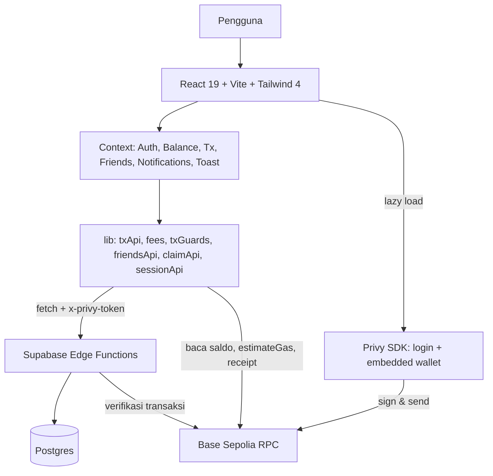

# Arsitektur Pukico Dashboard

**Status:** Diverifikasi terhadap kode commit `c8d90ef` (2 November 2026). Dokumen ini menjelaskan cara kerja dashboard saat ini, bukan rencana.

## 1. Prinsip

1. Frontend bukan sumber kebenaran status pembayaran. Ia menampilkan apa yang dikembalikan backend dan chain.
2. Wallet tetap di tangan pengguna. Aplikasi tidak membuat wallet baru dan tidak menyimpan private key.
3. Satu jalur kirim. Semua pengiriman dana melewati `SendSheetContent` dan `lib/txGuards.ts`.
4. Angka uang tidak pernah memakai floating point di jalur transaksi.
5. Backend dipanggil lewat HTTP ke Edge Function; browser tidak memegang kredensial database.

## 2. Gambaran komponen



Responder on-chain hanya dua: Privy/viem untuk mengirim dan membaca, backend untuk memverifikasi. UI tidak pernah menandai transaksi sukses atas dasar hash saja.

## 3. Lapisan aplikasi

### 3.1 Bootstrap (`src/main.tsx`, `src/App.tsx`)

Urutan provider: `LangProvider` → `AuthProvider` → (setelah sesi ada) `ToastProvider` → `BalanceProvider` → `TxProvider` → `NotificationsProvider` → `FriendsProvider` → `AppLayout`.

`AuthProvider` memilih salah satu dari tiga mode:

- **Demo** — `DemoAuthProvider` lokal, profil `andika` dengan role `admin`, tanpa jaringan.
- **Konfigurasi hilang** — layar `ConfigurationMissingScreen` dengan tombol masuk demo manual.
- **Live** — `PrivyConnectedProvider` di-*lazy load* agar bundel konektor wallet tidak dievaluasi di mode demo.

Selama `isPrivyReady` false atau sesi sedang dimuat tanpa profil, layar splash ditampilkan. Setelah sesi ada, `App` memanggil `resubmitPendingTransactions` sekali per mount untuk mengirim ulang transaksi yang tercatat di localStorage.

### 3.2 Context

| Context | Tanggung jawab | Sumber data |
| --- | --- | --- |
| `AuthContext` | Sesi, profil, token akses, MFA, export wallet | Privy + `/session` |
| `BalanceContext` | Saldo ETH/USDC, status RPC, refresh | viem `publicClient` |
| `TxContext` | Daftar transaksi, sync pending, cache | `/tx` action `list` dan `sync_pending` |
| `FriendsContext` | Daftar teman, pencarian, tambah/hapus, state sheet kirim | `/friends` |
| `NotificationsContext` | Notifikasi server, hitungan belum dibaca, sheet detail tx | `/tx` action `notifications` |
| `ToastContext` | Antrean toast, dedupe, update in-place | lokal |

`PrivyConnectedProvider` menyediakan `getAccessToken()` yang dipakai semua modul API sebagai header `x-privy-token`.

### 3.3 Modul `src/lib`

| Modul | Isi |
| --- | --- |
| `config.ts` | `ENV`, `CHAIN_CONFIG` (84532), `APP_METADATA`, validasi App ID Privy |
| `viemClient.ts` | `publicClient`, alamat USDC Base Sepolia `0x036C…CF7e`, baca saldo, cek RPC |
| `fees.ts` | Fee bps, treasury, `computeServiceFee`, gas reserve, maksimum yang bisa dikirim, fee tertunda di localStorage |
| `txGuards.ts` | Guard alamat, `buildTransferRequest`, `estimateGas`, validasi hash |
| `txApi.ts` | Semua panggilan `/tx`, resolve ID, daftar transaksi, data demo |
| `feeRetry.ts` | Pembayaran ulang fee tertunda |
| `friendsApi.ts` | Panggilan `/friends` |
| `claimApi.ts` | Klaim Pukico ID dan redeem kode akses |
| `sessionApi.ts` | Sinkronisasi sesi ke `/session` |
| `notificationsApi.ts` | Panggilan notifikasi (lewat `/tx`) |
| `receiptImage.ts` | Render receipt PNG di canvas |
| `addressSafety.ts` | Checksum, pemecahan alamat, jarak levenshtein, deteksi alamat mirip |
| `externalRecipient.ts` | Parsing input penerima, validasi alamat eksternal, deteksi kontrak |
| `formatters.ts` | Format USDC/ETH, tanggal, angka per locale |
| `iframeCompat.ts` | Shim untuk preview di iframe AI Studio |

### 3.4 Routing

Tidak ada router library. Tab aktif disimpan di state `ActiveTab`:

```
home | friends | discover | history | settings | receive | dev
```

- Perubahan tab menulis `window.location.hash` (`#history`, `#settings`, …); `home` mengosongkan hash.
- Saat mount, `hash` atau `path` dibaca sekali dan `hashchange` didengarkan.
- Tab yang pernah dibuka tetap ter-mount, disembunyikan dengan `hidden` + `inert`, dan posisi scroll dipulihkan per tab.
- `#pay=<kode>` **belum** ditangani. Landing page mengarahkan tautan pembayaran ke hash tersebut.

## 4. Alur kirim

Sumber: `src/components/views/sheets/SendSheetContent.tsx` (±3.700 baris).

1. Pengguna memasukkan Pukico ID atau alamat `0x`.
2. `parseRecipientInput` menentukan mode internal/eksternal; alamat divalidasi `isAddress` + `checkRecipientAddress`.
3. Mode internal memanggil `/resolve-id`, yang mengembalikan `wallet_address`, `is_self`, dan `address_changed`.
4. Nominal diubah ke unit integer (`parseUnits`) lalu fee dihitung `computeServiceFee`.
5. Saldo ETH/USDC dimuat, kebutuhan gas dihitung `computeEthRequirement` (buffer 150%).
6. Ringkasan ditampilkan; pengguna menekan review lalu konfirmasi.
7. Snapshot transaksi dikunci (`LockedTransfer`) agar input tidak berubah di tengah jalan.
8. `simulateTransfer` menjalankan `estimateGas`; kegagalan membatalkan sebelum tanda tangan.
9. `sendTransaction` Privy menandatangani dan menyiarkan; hash divalidasi `isTxHash`, lalu disimpan ke `pukico.pendingTx`.
10. `submitTxWithRetry` mengirim hash ke `/tx` action `submit`, mengulang tiap 2 detik sampai 20 detik selama backend menjawab `202 tx_not_found_yet`.
11. Bila fee aktif: tunggu `waitForTransactionReceipt` (timeout 60 detik), baca ulang saldo, lalu kirim transaksi fee terpisah ke treasury dengan 3 percobaan (jeda 0/1,5/3 detik).
12. Fee yang gagal disimpan di `pukico.fee_due.<wallet>` dan dapat dibayar dari detail transaksi. Transfer utama tetap dianggap berhasil.

Status akhir berasal dari backend (`/tx` action `sync`/`sync_pending`) dan receipt chain, bukan dari respons UI.

## 5. Alur resolve ID

`POST /functions/v1/resolve-id` dengan body `{ pukico_id }` atau `{ address }`.

1. Function membaca `x-privy-token`, mengambil DID pemanggil.
2. Memeriksa profil pemanggil ada dan sudah punya `pukico_id` (kecuali `role = admin`), jika tidak → `403 onboarding_required`.
3. Mencari profil target dengan `wallet_verified = true`.
4. Mengambil transaksi terakhir pemanggil → target; bila `to_address` berbeda dari alamat sekarang, mengembalikan `address_changed`, `previous_address`, `last_sent_at`.

Frontend menampilkan peringatan alamat berubah sebelum pengguna melanjutkan.

## 6. Alur klaim ID dan akses beta

`POST /functions/v1/claim-pukico-id` dengan `action`: `init`, `check`, `claim`, `redeem`.

1. `init` menyiapkan sesi klaim.
2. `check` memeriksa ketersediaan format `^[a-z0-9_]{3,20}$` dan kata terlarang.
3. `claim` menetapkan ID secara permanen dan memperbarui profil.
4. `redeem` menukar kode akses beta; `AccessCodeView` dipakai selama `beta_access` false dan role bukan `admin`.

## 7. Kontrak backend

Semua panggilan `POST` dengan header `Content-Type: application/json`, `apikey: <anon key>`, dan `x-privy-token: <token Privy>`.

| Endpoint | Action | Dipakai oleh | Ada di repo |
| --- | --- | --- | --- |
| `/functions/v1/resolve-id` | — | `txApi.resolvePukicoId`, `resolvePukicoByAddress` | ✅ `supabase/functions/resolve-id` |
| `/functions/v1/tx` | `submit`, `sync`, `sync_pending`, `list`, `notifications`, `mark_read`, `fee_report` | `txApi`, `notificationsApi` | ❌ |
| `/functions/v1/friends` | `list`, `search`, `profile`, `add`, `remove` | `friendsApi` | ❌ |
| `/functions/v1/claim-pukico-id` | `init`, `check`, `claim`, `redeem` | `claimApi` | ❌ |
| `/functions/v1/session` | — | `sessionApi` | ❌ |

Empat dari lima fungsi tidak ada di repo ini. Repo tidak dapat di-deploy dari nol tanpa fungsi tersebut; lihat bagian batas di bawah.

Bentuk `UserProfile` yang diharapkan dari `/session`: `privy_did`, `email_hint`, `wallet_address`, `wallet_verified`, `pukico_id`, `role`, `beta_access`.

## 8. State lokal

Seluruh state persisten di browser bersifat cache atau preferensi — tidak ada token yang disimpan.

| Key | Isi |
| --- | --- |
| `pukico.lang` | Bahasa aktif (`en`/`id`) |
| `pukico.pendingTx` | Hash yang sudah disiarkan tetapi belum diterima backend |
| `pukico.fee_due.<wallet>` | Fee tertunda yang belum terbayar |
| `pukico.last_fee_log` | Diagnostik percobaan fee terakhir |
| `pukico_tx_cache_<wallet>` | Cache daftar transaksi |
| `pukico_balance_cache_<wallet>` / `pukico_balances_*` | Cache saldo |
| `pukico_friends_cache_<wallet>` | Cache daftar teman |
| `pukico.notif.seen.<wallet>` / `pukico.notif.clearedAt.<wallet>` | Status baca notifikasi |
| `pukico.history_filters` | Filter riwayat (sessionStorage) |
| `pukico_balance_hidden`, `pukico_dismiss_passkey_nudge` | Preferensi UI |

Cache di-key per alamat wallet sehingga berganti akun tidak mencampur data. Logout hanya membersihkan `pukico.history_filters`; cache lain tetap ada sampai ditimpa.

## 9. Mode demo

Diaktifkan ketika `ENV.IS_DEMO_MODE` true. Konsekuensinya:

- `DemoAuthProvider` menyediakan profil `andika` (role `admin`, `beta_access` true) tanpa Privy.
- `txApi` mengembalikan `DEMO_TXS` (6 transaksi inti + 80 transaksi generated) dan mensimulasikan submit/sync sukses.
- `resolvePukicoId` memakai data statis: `rina`, `alex` (alamat berubah), `andika` (diri sendiri).
- `friendsApi`, `claimApi`, `notificationsApi` memakai data contoh dengan jeda buatan.
- Fee memakai treasury `0x3333…3333` dan bps default 50.

Tidak ada data demo yang dikirim ke jaringan nyata.

## 10. Keputusan desain dan alasannya

- **Privy di-lazy load** — konektor wallet berat; mode demo tidak perlu memuatnya sama sekali.
- **Cache per wallet di localStorage** — daftar transaksi tetap terlihat saat offline atau RPC lambat, tanpa mencampur akun.
- **Polling hanya saat tab terlihat** — `TxContext` menghentikan timer ketika `document.hidden`, mengurangi beban RPC.
- **Submit tetap walaupun backend lambat** — transaksi yang sudah disiarkan masuk `pukico.pendingTx` dan dikirim ulang saat sesi berikutnya, sehingga tidak hilang bila pengguna menutup tab.
- **Fee sebagai transaksi kedua** — memisahkan transfer dari biaya layanan agar kegagalan fee tidak membatalkan transfer, dengan konsekuensi pengguna membayar gas dua kali.
- **Tab yang sudah dibuka tetap ter-mount** — mempertahankan state form dan scroll; biaya memorinya kecil karena jumlah tab terbatas.

## 11. Batas yang belum dipastikan

- Implementasi empat Edge Function yang tidak ada di repo (`tx`, `friends`, `claim-pukico-id`, `session`). Skema tabel, policy RLS, dan cara verifikasi transaksi di sana tidak dapat diperiksa dari repo ini.
- Topologi deployment (domain `app.pukico.xyz`, konfigurasi Vercel, proyek Supabase aktif).
- Perilaku `#pay=` yang dijanjikan landing page.
- `ComingSoonView` masih di-import di `App.tsx` tetapi tidak dirender — sisa fitur yang belum dipakai.
