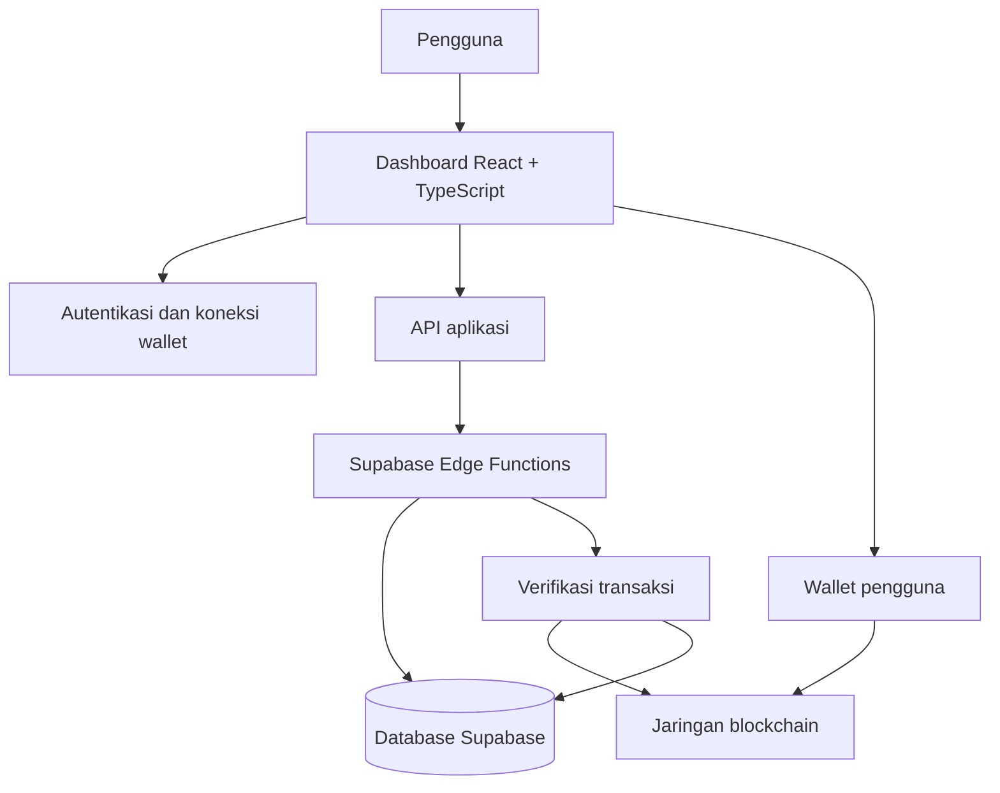

# Arsitektur Pukico

Dokumen ini menjelaskan gambaran arsitektur produk untuk pembaca publik. Ini bukan diagram deployment lengkap atau dokumentasi kontrak API yang stabil.

## 1. Gambaran umum

Pukico memisahkan antarmuka pengguna, integrasi wallet, layanan backend, dan sumber kebenaran transaksi.

Diagram ini bersifat konseptual. Implementasi tiap alur harus diperiksa pada kode yang sedang dirilis.

## 2. Lapisan aplikasi

### Antarmuka
Dashboard yang diperiksa menggunakan React, TypeScript, dan Vite. Antarmuka mengatur navigasi, form, status loading, pesan kesalahan, serta detail transaksi.

Komponen UI sebaiknya tidak menjadi sumber kebenaran untuk status pembayaran atau otorisasi.

### Autentikasi dan wallet
Integrasi Privy digunakan untuk pengalaman autentikasi dan wallet. viem digunakan untuk interaksi blockchain yang relevan. Pengguna tetap menyetujui dan menandatangani transaksi melalui mekanisme wallet yang terintegrasi.

Pukico tidak seharusnya meminta pengguna menyerahkan private key.

### API aplikasi
Modul API di frontend memisahkan permintaan data dari komponen tampilan. Misalnya, kode dashboard memiliki modul terpisah untuk transaksi, teman, sesi, dan notifikasi.

### Edge Functions
Edge Functions menjadi batas server untuk operasi yang memerlukan validasi atau akses database. Setiap fungsi harus memverifikasi identitas pemanggil dan otorisasi tindakan, bukan hanya menerima klaim dari frontend.

### Database
Supabase menyimpan data aplikasi seperti profil, teman, transaksi, dan notifikasi. Skema serta kebijakan akses dapat berubah; perubahan database harus mengikuti migrasi dan peninjauan keamanan yang sesuai.

### Blockchain
Blockchain menjadi sumber bukti untuk hasil transaksi on-chain. Respons UI, transaction hash, atau status lokal saja tidak cukup untuk menyatakan transaksi sukses.

## 3. Alur transfer

1. Pengguna memilih penerima.
2. Aplikasi menyelesaikan Pukico ID ke identitas atau wallet yang relevan.
3. Aplikasi memvalidasi input dan menyiapkan transaksi.
4. Rincian biaya ditampilkan sebelum konfirmasi.
5. Pengguna menyetujui dan menandatangani transaksi melalui wallet.
6. Sistem memeriksa hasil transaksi berdasarkan jaringan yang benar.
7. Status dan detail transaksi ditampilkan kepada pengguna.

Rincian biaya harus membedakan service fee dari network fee. Network fee dibayar dalam aset gas jaringan, yang tidak selalu sama dengan token yang ditransfer.

## 4. Request Money

Request Money direncanakan sebagai domain terpisah dari transaksi blockchain.

Tanggung jawab yang disarankan:
- **Request API / Edge Function:** membuat dan membaca permintaan, memvalidasi akses, serta menangani pembatalan atau transisi status yang diizinkan.
- **Data permintaan:** menyimpan pembuat, penerima jika ditentukan, nominal, jaringan, waktu, dan status.
- **Alur Send yang sudah ada:** tetap bertanggung jawab atas persetujuan dan pengiriman dana.
- **Verifikasi transaksi:** memastikan pembayaran cocok dengan permintaan sebelum status berubah menjadi paid.

Membuat permintaan tidak mengirim dana. Jangan menerima status `paid` hanya karena frontend mengirim nilai tersebut.

## 5. Notifikasi transfer masuk

Notifikasi masuk direncanakan bergantung pada deteksi transfer, verifikasi jaringan dan token, serta penyimpanan event yang idempotent. Satu peristiwa on-chain yang diproses ulang tidak boleh membuat notifikasi ganda.

## 6. Prinsip perubahan

- Pertahankan komponen dan alur yang sudah berjalan.
- Hindari duplikasi logika transaksi.
- Jangan menambahkan tabel jika struktur yang ada cukup.
- Pisahkan state UI dari status bisnis yang harus diverifikasi server.
- Gunakan migrasi untuk perubahan skema.
- Tambahkan pengujian untuk status pending, gagal, duplikat, dan akses lintas pengguna.
- Dokumentasikan keterbatasan jika sumber data belum tersedia.

## 7. Batas dokumentasi

Dokumen ini tidak memublikasikan URL internal, nama secret, kredensial, detail konfigurasi deployment, atau aturan kontrak yang belum diverifikasi. Untuk integrasi spesifik, rujuk kode dan dokumentasi teknis yang sesuai dengan versi rilis.
